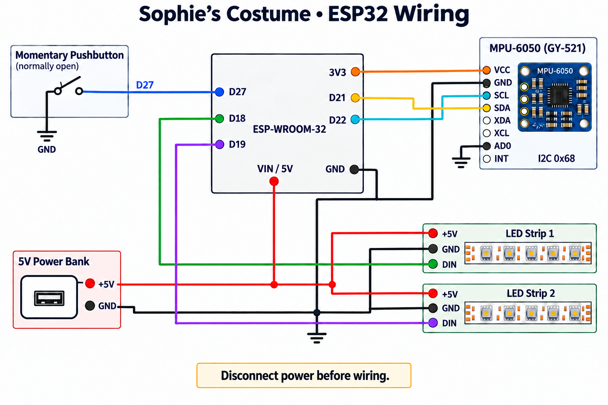

# Stitch jump-reactive costume

An ESP32 reads motion from a hoodie-mounted IMU and runs a small jump classifier on the costume. A detected jump makes the ear and belly lights sweep up and down, then returns to the selected effect. The costume runs offline after flashing.

- [Wiring, parts and assembly](docs/hardware.md)
- [Arduino sketch](firmware/Arduino_Stitch_Costume_AI_Final_20261010_v01_Good/Arduino_Stitch_Costume_AI_Final_20261010_v01_Good.ino)
- [Model library and training details](models/README.md)

## Model library not included

The public repository omits `AP8G1s_20261009_v01.zip`, which bundled the trained model with generated Edge Impulse SDK files subject to [redistribution restrictions](https://www.edgeimpulse.com/legal/terms-of-service). The archive is excluded from both the files and the public Git history. The firmware still requires a compatible Arduino model library; see [Model setup](models/README.md) for installation and export options.

## Flash the costume

1. In Arduino IDE, install Espressif's **esp32** board package and **FastLED**. The project used ESP32 core **3.3.12** and FastLED **3.7.8** for local builds. Other combinations may behave differently; an earlier FastLED 3.10.6 build hit duplicate FFT symbols.
2. Select **Sketch → Include Library → Add .ZIP Library** and install your authorized Arduino model export. See [Model setup](models/README.md); the sketch expects `AP8G1s.h`.
3. Open the linked sketch from its own folder. Keep `AIEngine.h`, `RuntimeSupport.h` and `build_opt.h` beside it. Select **ESP32 Dev Module** and the board's USB port. Verify, then upload. Use **115200** upload speed if a faster setting is unreliable.
4. Check both LED zones, the pushbutton, and jump detection with the sensor mounted. Serial Monitor at **115200 baud** shows AI and jump events, sensor failures/recovery, and minute-by-minute health and memory summaries.

The firmware is copied as saved. Its startup banner still says 130 belly LEDs, but the actual compiled constant is **120** (62 ears + 120 belly). Adjust the LED count constants if your strips differ.

## Button controls

| Gesture | Action |
|---|---|
| Short press | Next LED mode; exits the secret mode if active |
| Three quick presses | Enter the secret effect |
| Hold 1 second, then release | Cycle brightness: 25, 50, 90, 140 |
| Hold 3.5 seconds | Toggle AI; ears and belly flash green for on or red for off, then restore brightness from before the press |
| Keep holding to 6 seconds | Lights off |
| Short press while off | Wake with AI enabled |

Boot starts at brightness 25 with AI enabled. The 1-second brightness step can appear during a longer hold. An accepted jump runs a complete simultaneous sweep on both zones (~0.70 s up + ~0.70 s down), followed by a 500 ms cooldown. An explicit lights-off command can cancel an effect.

The shared LED/I²C mutex keeps LED output and sensor transactions from overlapping. A missed read discards the current inference window; three consecutive sample-read failures trigger sensor reconfiguration. Normal lighting continues during sensor recovery.

The earlier debug build logged a nearly 16-minute test without I²C errors or sampling gaps, including mode changes and jumps. That is evidence for the coordination fix, not a new test of this packaged firmware.
