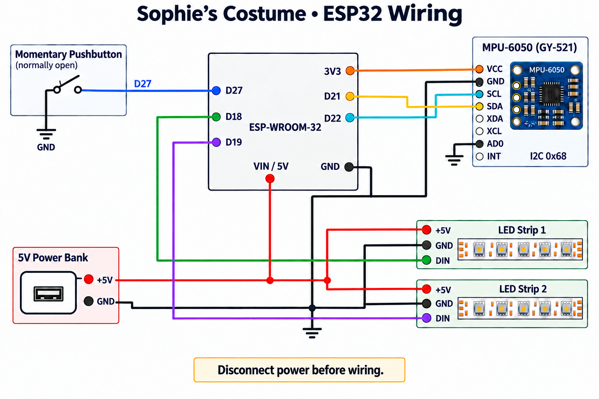

# Hardware and wiring

## Parts

- Stitch hoodie with two zones of 5 V WS2812B-compatible, GRB addressable strip. The final firmware drives 62 pixels for the ears and 120 for the belly.
- ESP-WROOM-32 development board with a 5 V/VIN input and a 3.3 V output.
- GY-521-style six-axis IMU breakout. The original listing/diagram says MPU-6050; the actual sensor reported `WHOAMI=0x70` (MPU6500). The firmware supports both IDs.
- Normally open momentary pushbutton, regulated 5 V power bank, wiring, insulation, and strain relief.

## Wiring schematic

| From | To |
|---|---|
| ESP32 GPIO18 (D18) | Ear strip **DIN** |
| ESP32 GPIO19 (D19) | Belly strip **DIN** |
| ESP32 GPIO27 (D27) | One button lead; other lead to common GND |
| ESP32 GPIO21 (D21) | IMU SDA |
| ESP32 GPIO22 (D22) | IMU SCL |
| ESP32 3V3 | IMU VCC on the breakout used here |
| Common GND | ESP32 GND, IMU GND and AD0, button, both strips, power bank negative |
| Regulated 5 V from power bank | ESP32 VIN/5V and both strips' +5V inputs, in parallel |

AD0 low selects I²C address `0x68`; the sketch also probes `0x69`. Leave INT, XDA and XCL unconnected. GPIO27 uses an internal pull-up, so the button needs no voltage feed.

## Assembly and checks

- Match the actual board labels before wiring. Disconnect the power bank before plugging in USB unless your board's power isolation is verified. Power the strips directly from the 5 V supply, not from the ESP32's 3V3 pin. Use a supply and wiring rated for the strip's load.
- Check the strip arrows. The ESP32 connects to **DIN**; the wrong end can show 5 V at the pads while the LEDs stay dark.
- Insulate connections and add strain relief at the strips, button, and pocket enclosure. Mount the IMU firmly in a repeatable orientation so it moves with the garment rather than swinging on its wires. Keep the power bank removable.
- First check both zones and button gestures at low brightness. Then switch modes and brightness while jumping. Look for full sweeps, restoration of the previous mode, and no new I²C errors. If a zone is dark, check supply at the strip, common ground, and DIN direction before changing firmware.
